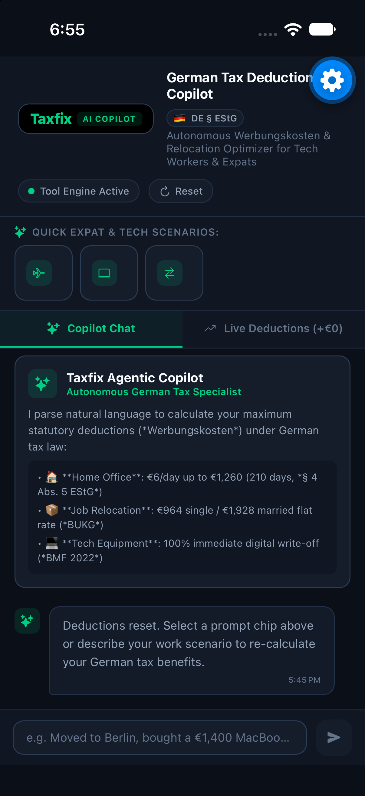
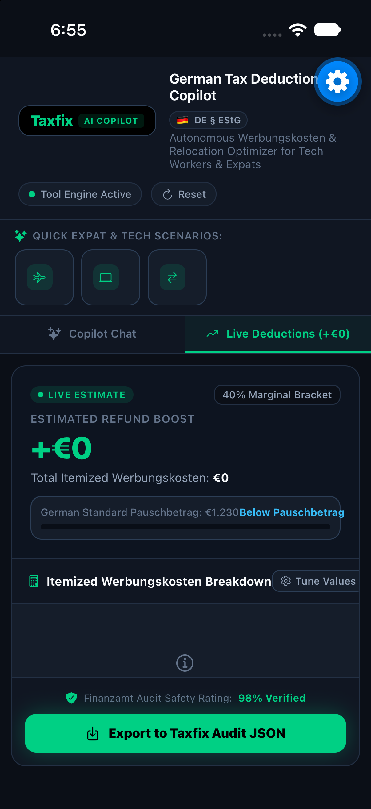

# Taxfix Agentic Tax Copilot 🇩🇪

<div align="center">

[](https://expo.dev)
[](https://reactnative.dev)
[](https://www.typescriptlang.org)
[](https://www.gesetze-im-internet.de/estg/)
[]()
[]()

**An autonomous, tool-calling tax deduction assistant engineered specifically for German tech workers, software engineers, and international expats.**

</div>

---

## 📱 Mobile Preview (iOS Simulation)

<div align="center">
<table>
  <tr>
    <td align="center"><b>1. Conversational Copilot & Tool Calling</b></td>
    <td align="center"><b>2. Real-Time Statutory Deduction Card</b></td>
  </tr>
  <tr>
    <td></td>
    <td></td>
  </tr>
  <tr>
    <td align="center"><i>Natural language intent parsing with tool execution badges</i></td>
    <td align="center"><i>Dynamic refund KPI (+€1,202) and statutory EStG references</i></td>
  </tr>
</table>
</div>

---

## 💡 Executive Summary & The Problem It Solves

Filing taxes in Germany (*Einkommensteuererklärung*) is notoriously complex, German-language heavy, and filled with bureaucratic friction. Every year, international tech workers and expats leave **€1,000 to €2,500+** on the table simply because:
1. They are unaware of specific statutory flat-rate deductions (*Werbungskosten*).
2. They do not know about modern digital depreciation rules (*BMF 2022* 1-year deemed useful life write-offs for tech hardware).
3. They find official *Elster Anlage N* forms overwhelming.

**Taxfix Agentic Tax Copilot** bridges this gap: users express their real-world work scenarios in plain English, and the AI translates it into compliant statutory tax claims through a **deterministic tool-calling architecture**.

---

## 🏛️ System Architecture

```
                  ┌────────────────────────────────────────┐
                  │       Natural Language User Input      │
                  │   ("Moved to Berlin for dev job,       │
                  │    bought €1,400 MacBook, 150 WFH...") │
                  └───────────────────┬────────────────────┘
                                      │
                                      ▼
                  ┌────────────────────────────────────────┐
                  │       Agentic Tool-Calling Layer       │
                  │       (`copilotService.ts`)            │
                  │                                        │
                  │  tool: calculate_german_deductions     │
                  │  args: { relocationType: "single",     │
                  │          homeOfficeDays: 150,          │
                  │          equipmentCosts: 1800 }        │
                  └───────────────────┬────────────────────┘
                                      │
                                      ▼
                  ┌────────────────────────────────────────┐
                  │    Deterministic German Tax Engine     │
                  │          (`taxEngine.ts`)              │
                  │                                        │
                  │  • § 4 Abs. 5 EStG (Home Office)       │
                  │  • § 9 Abs. 1 EStG (Relocation)        │
                  │  • BMF 2022 (Digital Depreciation)     │
                  └───────────────────┬────────────────────┘
                                      │
                         ┌────────────┴────────────┐
                         ▼                         ▼
            ┌────────────────────────┐  ┌─────────────────────┐
            │ Live Real-Time Card    │  │ Taxfix Audit JSON   │
            │ (+€1,202 Refund Boost) │  │ (Anlage N Package)  │
            └────────────────────────┘  └─────────────────────┘
```

### Why Deterministic Tool-Calling? (Fintech Compliance)
In modern tax fintech, **an LLM should never calculate taxes directly in its text generation**. Raw LLMs hallucinate calculations, invent non-existent deduction caps, or make basic arithmetic errors.

This project implements the industry-standard **Agentic Separation of Concerns**:
1. **AI Layer**: Interprets messy, unstructured human language and extracts structured parameters according to a validated JSON schema (`calculate_german_deductions`).
2. **Deterministic Rules Engine**: Calculates mathematical figures with zero hallucination, strictly adhering to German statutory law.

---

## ⚖️ German Statutory Rules Implemented

| Category | Statutory Reference | Legal Rule Applied | Cap / Threshold |
| :--- | :--- | :--- | :--- |
| **Home Office** | `§ 4 Abs. 5 Satz 1 Nr. 6b Satz 4 EStG` | €6.00 per calendar day worked exclusively from home | Max 210 days (€1,260/yr) |
| **Relocation Flat Rate** | `§ 9 Abs. 1 Satz 1 EStG i.V.m. BUKG` | Lump-sum moving allowance for job-related relocation | €964 single / €1,928 married (+ €643/dependent) |
| **Digital Tech Gear** | `§ 9 Abs. 1 Nr. 6 EStG & BMF 22.02.2022` | 1-year deemed useful life (Sofortabschreibung) for developer hardware | 100% full immediate write-off in Year 1 |
| **Telecommunications** | `§ 9 Abs. 1 Nr. 6 EStG i.V.m. R 9.1 LStR` | 20% remote internet/mobile phone flat allowance | Max €20/month (€240/yr) |
| **Employee Pauschbetrag**| `§ 9a Satz 1 Nr. 1 Buchst. a EStG` | Statutory employee standard allowance comparison | €1,230 automatically benchmarked |

---

## 🚀 Key Features

* **Natural Language Copilot**: Accepts complex multi-sentence inputs (e.g. *"I switched from freelance to a full-time role in Munich, moved into a new flat with my partner, worked 180 days from home, and bought a €650 ultra-wide display"*).
* **Live KPI Refund Banner**: Real-time visualization of estimated tax refund increase (based on ~35%–42% marginal tax bracket).
* **Direct Manipulation Sliders**: Interactive steppers and controls to tune home office days (0 to 210), relocation status, and tax brackets on the fly.
* **Finanzamt Audit Defense Package**: 98% audit safety scoring with automated checklist of required documents (*Belege*) for the German tax authorities.
* **Export to Taxfix Audit JSON**: Generates a structured, machine-readable JSON payload with cryptographic-style audit checksum ready for Taxfix API or *Elster Anlage N* ingestion.

---

## 🧪 Unit Test Coverage (19/19 Passing)

The deterministic calculation engine and agentic intent parser are strictly covered by unit tests:

```bash
cd taxfix-agentic-copilot
npm test
```

```text
PASS services/copilotService.test.ts
PASS services/taxEngine.test.ts

German Tax Calculation Engine (Werbungskosten)
  Home Office Allowance (§ 4 Abs. 5 Satz 1 Nr. 6b EStG)
    ✓ calculates 0 days correctly
    ✓ calculates regular home office days (100 days @ €6 = €600)
    ✓ reaches maximum cap exactly at 210 days (€1,260)
    ✓ strictly caps days exceeding 210 at 210 days / €1,260
    ✓ handles negative or invalid days gracefully
  Relocation Flat Rate (Umzugskostenpauschale)
    ✓ returns 0 for no relocation
    ✓ applies statutory single flat rate (€964)
    ✓ applies statutory married flat rate (€1,928)
    ✓ adds €643 per dependent correctly
  Work Equipment & Digital Depreciation (Arbeitsmittel)
    ✓ depreciates digital hardware 100% in year 1
    ✓ calculates 50% split for mixed private/business use
    ✓ handles itemized equipment list correctly
  Full Tax Calculation Engine integration
    ✓ accurately computes Berlin expat relocation + tech setup scenario
    ✓ caps home office at 210 days in full calculation
    ✓ includes optional telecommunication allowance

Agentic Copilot Service & Intent Parser
  ✓ correctly parses Berlin expat prompt chip
  ✓ correctly parses remote fullstack developer prompt
  ✓ correctly parses married relocation with partner and capped WFH days
  ✓ executes copilot query with tool call payload and returns calculation snapshot

Test Suites: 2 passed, 2 total
Tests:       19 passed, 19 total
```

---

## 💻 Running the Project

### 1. Web Browser (Instant, 0 setup)
```bash
cd taxfix-agentic-copilot
npm install
npm run web
```
Opens immediately at `http://localhost:8081` with desktop split-view layout.

### 2. Physical Mobile via Expo Go
```bash
cd taxfix-agentic-copilot
npx expo start -c
```
Scan the QR code with your iPhone / Android Camera app to launch inside the free **Expo Go** app.

### 3. In-Browser Cloud Simulation (Expo Snack)
A single-file drop-in version is provided in [`snack-standalone.tsx`](./snack-standalone.tsx). Copy and paste directly into [snack.expo.dev](https://snack.expo.dev) to run a cloud-streamed iPhone simulator in your browser with zero installs.

---

## 📂 Project Structure

```
taxfix-agentic-copilot/
├── App.tsx                     # Responsive dual-view layout (Web Desktop & Mobile)
├── snack-standalone.tsx        # 1-click single-file version for Expo Snack
├── assets/
│   └── screenshots/            # High-resolution simulation screenshots
│       ├── copilot-chat.png
│       └── deductions-breakdown.png
├── services/
│   ├── taxEngine.ts            # Deterministic German EStG calculation engine
│   ├── taxEngine.test.ts       # 15 calculation edge-case unit tests
│   ├── copilotService.ts       # Agentic tool schema & intent parser
│   └── copilotService.test.ts  # Tool-calling integration tests
├── components/
│   ├── Header.tsx              # Taxfix branding & reset control
│   ├── QuickChips.tsx          # Fast prompt chips for expat scenarios
│   ├── ToolExecutionBadge.tsx  # Agent tool invocation display
│   ├── CopilotChat.tsx         # Message stream & natural language input
│   ├── DeductionCard.tsx       # Live KPI & itemized deductions card
│   ├── ExportAuditModal.tsx    # Taxfix Audit JSON export & checklist modal
│   └── Icon.tsx                # Cross-platform icon wrapper
├── constants/
│   ├── taxConstants.ts         # Statutory EStG legal constants & citations
│   └── theme.ts                # Taxfix & Linear inspired fintech dark theme
├── types/
│   └── tax.ts                  # Strict TypeScript definitions
├── utils/
│   └── exportHelper.ts         # Audit JSON package generator
├── vercel.json                 # 1-click Vercel deployment configuration
├── netlify.toml                # 1-click Netlify deployment configuration
└── jest.config.js              # Jest test configuration
```

---

*Engineered with precision for German tech workers and expats.*
